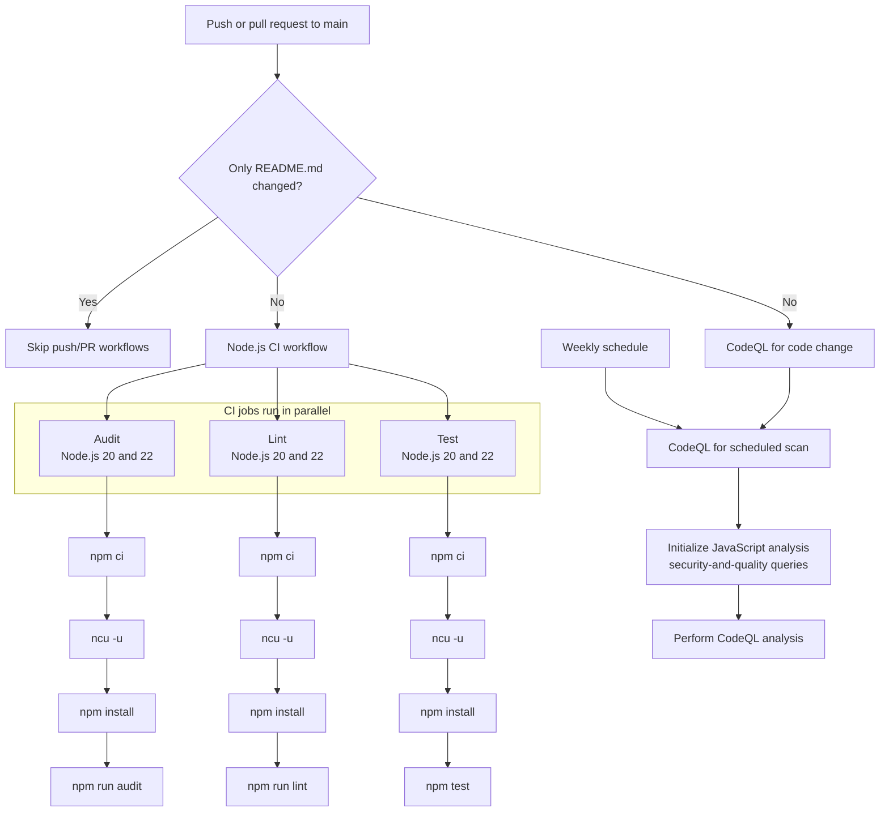

# Simple SPA Application

A small Single Page Application (SPA) demonstration built with Node.js and
Express. The application serves a responsive frontend, exposes sample REST
endpoints, and includes automated linting, dependency auditing, CodeQL
analysis, and tests using Node.js's built-in test runner.

## What the application does

- Serves the SPA frontend from the `public/` directory.
- Provides Home, About, and Contact pages.
- Provides sample JSON APIs for application data and users.
- Loads API data in the browser with client-side JavaScript.
- Uses modern JavaScript ES modules.
- Returns JSON responses for unknown routes and server errors.

## API and pages

| Method | Path | Description |
| --- | --- | --- |
| `GET` | `/` | Serves the main SPA page. |
| `GET` | `/about` | Serves the About page. |
| `GET` | `/contact` | Serves the Contact page. |
| `GET` | `/api/data` | Returns sample application data. |
| `GET` | `/api/users` | Returns a sample list of users. |

The server listens on port `3000` by default. Set the `PORT` environment
variable to use another port:

```bash
PORT=8080 npm start
```

On Windows PowerShell:

```powershell
$env:PORT = "8080"
npm start
```

## Getting started

### Requirements

- Node.js 20 or newer
- npm

### Install and run

Install the exact dependency versions recorded in the lockfile:

```bash
npm ci
```

Start the application:

```bash
npm start
```

Open [http://localhost:3000](http://localhost:3000) in a browser.

For development, use the watch mode to restart the server when files change:

```bash
npm run dev
```

## Available scripts

Run scripts from the project root with `npm run <script>`:

| Script | Command | Description |
| --- | --- | --- |
| `start` | `node server.js` | Starts the Express server. |
| `dev` | `node --watch server.js` | Starts the server with Node.js watch mode. |
| `test` | `node --test tests/*.js` | Runs all tests with Node.js's built-in test runner. |
| `lint` | `eslint .` | Checks JavaScript files with ESLint. |
| `audit` | `npm audit --audit-level=high` | Fails when high or critical dependency vulnerabilities are found. |
| `check-updates` | `ncu` | Reports available dependency updates without changing project files. |

Examples:

```bash
npm test
npm run lint
npm run audit
npm run check-updates
```

`npm run check-updates` reports newer package versions. To update the version
ranges in `package.json`, run the locally installed `ncu` command directly:

```bash
npx --no-install ncu -u
npm install
```

Review the resulting changes to `package.json` and `package-lock.json` before
committing them.

## Testing

The test suite uses Node.js's built-in `node:test` module and covers:

- Basic JavaScript assertions.
- Server startup and lifecycle behavior.
- API responses and response shapes.
- HTML pages and static assets.
- Unknown-route `404` responses.

Run the complete suite with:

```bash
npm test
```

## Continuous integration and security

GitHub Actions runs audit, lint, and test jobs in parallel for Node.js 20 and
22. The workflow installs dependencies, checks for package upgrades, audits
dependencies, and runs the relevant validation command.

A separate CodeQL workflow analyzes JavaScript using the
`security-and-quality` query suite on pushes, pull requests, and a weekly
schedule.

### Workflow



## Project structure

```text
├── package.json
├── package-lock.json
├── server.js
├── index.js
├── public/
│   ├── index.html
│   ├── styles.css
│   └── app.js
├── tests/
│   ├── test-api.js
│   ├── test-server.js
│   ├── test-integration.js
│   └── test-simple.js
├── .github/
│   └── workflows/
│       ├── ci.yml
│       └── codeql.yml
└── eslint.config.js
```

## License

ISC
